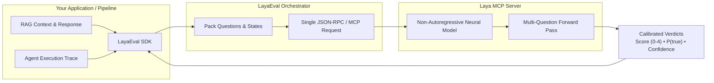

<p align="center">
  
</p>

<h1 align="center">LayaEval</h1>

<p align="center">
  <strong>Ultra-Fast Neural Evaluation Framework for Agent and RAG Systems</strong><br>
  <em>42 production-ready metrics &bull; Sub-50ms latency &bull; Zero external LLM judge costs &bull; Calibrated confidence</em>
</p>

<p align="center">
  <a href="https://pypi.org/project/layaeval/"></a>
  <a href="https://pypi.org/project/layaeval/"></a>
  <a href="https://github.com/VinayChaudhari1996/LayaEval/blob/main/LICENSE"></a>
  <a href="https://github.com/NandhaKishorM/laya"></a>
  <a href="https://github.com/astral-sh/uv"></a>
</p>

<p align="center">
  <a href="#table-of-contents">Documentation Index</a> &bull;
  <a href="#key-highlights">Highlights</a> &bull;
  <a href="#why-layaeval">Why LayaEval</a> &bull;
  <a href="#installation">Installation</a> &bull;
  <a href="#quickstart">Quickstart</a> &bull;
  <a href="#interactive-notebooks">Notebooks</a> &bull;
  <a href="#how-it-works">Architecture</a> &bull;
  <a href="#supported-metrics-catalog">Metric Catalog (42)</a> &bull;
  <a href="#cli-usage">CLI Reference</a> &bull;
  <a href="#acknowledgements--special-thanks">Acknowledgements</a> &bull;
  <a href="#license">License</a>
</p>

---

## Table of Contents

- [Key Highlights](#key-highlights)
- [Why LayaEval?](#why-layaeval)
- [Installation](#installation)
  - [Standard pip / uv](#installation)
  - [Google Colab & Jupyter Setup](#installation)
- [Quickstart & Real Code Examples](#quickstart)
  - [1. Instant Multi-Metric RAG Evaluation](#1-instant-multi-metric-rag-evaluation)
  - [2. Autonomous Agent Execution & Trace Evaluation](#2-autonomous-agent-execution--trace-evaluation)
  - [3. Direct Callable Metric Objects](#3-direct-callable-metric-objects)
  - [4. Managed Evaluator Context Session](#4-managed-evaluator-context)
  - [5. Dataset Benchmark Evaluation & Reports](#5-dataset-evaluation--reporting)
  - [6. Infrastructure Detection & Progress Tracking](#6-infrastructure-detection--progress-tracking)
- [Interactive Notebooks](#interactive-notebooks)
- [How It Works & Architecture](#how-it-works)
- [Supported Metrics Catalog (42 Metrics)](#supported-metrics-catalog)
  - [1. RAG Metrics Catalog (20 Metrics)](#1-rag-metrics-catalog-20-metrics)
  - [2. Agent Metrics Catalog (22 Metrics)](#2-agent-metrics-catalog-22-metrics)
- [CLI Usage Reference](#cli-usage)
- [Development & Testing](#development--testing)
- [Acknowledgements & Special Thanks](#acknowledgements--special-thanks)
- [License](#license)

**LayaEval** is an ultra-fast, developer-first Python evaluation SDK for **Agentic workflows and RAG pipelines**, powered by the **Laya MCP Server**.

LayaEval brings **42 production-grade evaluation metrics** (20 RAG metrics + 22 Agent metrics) directly into your CI/CD and production verification loops—executed as calibrated, non-autoregressive neural decisions with **zero external LLM API cost** and **sub-50ms latency**.

---

## Key Highlights

- **Sub-50ms Latency**: Non-autoregressive neural verification replaces slow, multi-second LLM-as-a-judge roundtrips.
- **Zero External Token Cost**: No OpenAI or Anthropic API bills for running quality guardrails and regression suites.
- **42 Production-Ready Metrics**: Comprehensive coverage spanning retrieval quality, groundedness, hallucination risk, multi-step agent traces, tool accuracy, policy compliance, and prompt injections.
- **Single Forward Pass Batching**: Evaluates multiple metrics for an interaction in a unified forward pass for optimal throughput.
- **Calibrated Confidence**: Outputs statistical probabilities ($P(\text{true})$), standard confidence intervals, and configurable pass/fail thresholds.
- **Native MCP Integration**: Direct connection via stdio JSON-RPC or embedded runtime to the Laya MCP ecosystem.
- **Ultra Lightweight**: Zero heavy dependencies required at install time (`numpy` only).

---

## Why LayaEval?

| Feature | Traditional LLM-as-a-Judge | LayaEval |
| :--- | :--- | :--- |
| **Latency per Metric** | 1,500ms – 5,000ms | **< 50ms** |
| **API Cost** | ~$0.01 – $0.05 per eval call | **$0.00 (Zero external API fees)** |
| **Determinism & Calibration** | Brittle prompt parsing & hallucinations | **Calibrated neural probabilities & confidence** |
| **Multi-Metric Evaluation** | Sequential calls or bloated judge prompts | **Single forward-pass batching** |
| **CI/CD Regression Suitability** | Slow, flaky, expensive | **Fast, offline-capable, cost-free** |
| **Dependencies** | Bulky orchestration frameworks | **Ultra-lightweight (`numpy` only)** |

---

## Installation

Install via [`uv`](https://github.com/astral-sh/uv) (recommended) or `pip`:

```bash
# Core package (ultra-lightweight, connects to existing laya-mcp-server)
uv add layaeval

# Or with full local Laya runtime included:
uv add "layaeval[laya]"
```

Using standard `pip`:

```bash
pip install layaeval
# Or with local Laya runtime & MCP server:
pip install "layaeval[laya]"
```

> **Google Colab / Jupyter Notebooks**:
> ```bash
> !pip install "layaeval[laya]"
> ```

---

## Quickstart

### 1. Instant Multi-Metric RAG Evaluation

Evaluate multiple metrics in a single neural forward pass with zero boilerplate:

```python
import layaeval

results = layaeval.evaluate(
    ["groundedness", "hallucination", "response_relevance"],
    query="What is the capital and population of France?",
    retrieved_context="Paris is the capital and most populous city of France, with 2.1M residents.",
    response="Paris is the capital of France, home to about 2.1 million people.",
)

for r in results:
    print(
        f"[{r.metric_name:<20}] Passed: {r.passed:<5} | Value: {r.value:.2f} | Confidence: {r.confidence:.2f}"
    )
```

**Output:**
```text
[groundedness        ] Passed: True  | Value: 3.80 | Confidence: 0.94
[hallucination       ] Passed: True  | Value: 0.06 | Confidence: 0.95
[response_relevance  ] Passed: True  | Value: 3.80 | Confidence: 0.94
```

---

### 2. Autonomous Agent Execution & Trace Evaluation

Audit multi-step tool calls, goal achievement, and task completion using metric classes or identifiers:

```python
import layaeval
from layaeval import TaskCompletion, ToolCallAccuracy

task = "Find user #104 and check subscription status."
trace = "Step 1: db.query(user_id=104) -> Plan: Pro\nStep 2: stripe.check(sub_id=sub_104) -> Active"
result = "User #104 has an active Pro subscription."

res = layaeval.evaluate(
    TaskCompletion(threshold=0.75),
    task=task,
    agent_trace=trace,
    final_result=result,
)

print(f"Task Completed: {res.passed} (P(true) = {res.noul:.2f}, confidence = {res.confidence:.2f})")
```

**Output:**
```text
Task Completed: True (P(true) = 0.94, confidence = 0.95)
```

---

### 3. Direct Callable Metric Objects

Metric objects can be instantiated with custom thresholds and called directly like standard functions:

```python
from layaeval import Groundedness

groundedness = Groundedness(threshold=3.0)

res = groundedness(
    retrieved_context="Paris is the capital of France.",
    response="Paris is the capital.",
)

print(f"Passed: {res.passed} (Score: {res.score}/4.0 | Confidence: {res.confidence:.2f})")
```

**Output:**
```text
Passed: True (Score: 3.80/4.0 | Confidence: 0.94)
```

---

### 4. Managed Evaluator Context

For dedicated server processes, custom models, or high-throughput batch sessions:

```python
from layaeval import Evaluator, Groundedness, HallucinationRisk

with Evaluator(model="auto") as ev:
    results = ev.evaluate(
        [Groundedness(threshold=3.0), HallucinationRisk(threshold=0.2)],
        retrieved_context="Revenue grew by 24% year-over-year.",
        response="The company posted 24% YoY revenue growth.",
    )
    for r in results:
        print(f"{r.metric_name}: {r.passed} (Score/Risk: {r.value:.2f})")
```

**Output:**
```text
groundedness: True (Score/Risk: 3.80)
hallucination: True (Score/Risk: 0.06)
```

---

### 5. Dataset Evaluation & Reporting

Run evaluations against entire benchmark datasets and generate structured summary reports:

```python
from layaeval import EvalDataset, evaluate

dataset = EvalDataset.from_jsonl("eval_benchmark.jsonl")

report = evaluate(
    dataset,
    metrics=["groundedness", "hallucination", "response_relevance"],
    name="v1.2-rag-baseline",
)

print(report.summary())
print(f"Pass Rate: {report.pass_rate * 100:.1f}%")
print(f"Total Evaluations: {report.total_evaluations}")
report.save("eval_report.json")
```

**Output:**
```text
======================================================================
LayaEval Evaluation Report  (Total: 9, Pass Rate: 100.0%)
======================================================================
Metric                       Type     Count   Pass Rate    Mean Value
----------------------------------------------------------------------
groundedness                 score    3       100.0%       3.80/4.0  
hallucination                noul     3       100.0%       6.00%     
response_relevance           score    3       100.0%       3.80/4.0  
======================================================================
Pass Rate: 100.0%
Total Evaluations: 9
```

---

### 6. Infrastructure Detection & Progress Tracking

LayaEval automatically detects your compute infrastructure (NVIDIA CUDA GPUs, Apple Silicon Metal/MPS, or multi-core CPUs) and displays real-time progress bars as well as internal process visibility (including HuggingFace model weight downloads and MCP server initialization):

```python
import layaeval

# 1. Check your compute accelerator
hw = layaeval.detect_hardware()
print(hw.description)

# 2. Evaluate dataset with real-time progress bar (enabled by default)
report = layaeval.evaluate(dataset, metrics=["groundedness", "hallucination"], progress=True)
```

**Output:**
```text
[LayaEval] Hardware: GPU: NVIDIA A100-SXM4-40GB (CUDA, 40.0 GB VRAM, Device 0)
[LayaEval] Initializing Laya MCP Server (model: auto)...
[LayaEval] Evaluating (v1.2-rag-baseline): [████████████████████████] 100% (50/50 examples)
```

*(Note: To silence progress output in CI/CD, set `progress=False` or export `LAYAEVAL_PROGRESS=0`)*

---

## Interactive Notebooks

Hands-on Jupyter notebooks with end-to-end code, real-world examples, and step-by-step walkthroughs are available in the [`examples/notebook/`](https://github.com/VinayChaudhari1996/LayaEval/tree/main/examples/notebook) folder:

| Evaluation Domain | Notebook File Path | Workflows & Metrics Covered | Run Command |
| :--- | :--- | :--- | :--- |
| **RAG Evaluation** | [`examples/notebook/rag_metrics_evaluation.ipynb`](https://github.com/VinayChaudhari1996/LayaEval/blob/main/examples/notebook/rag_metrics_evaluation.ipynb) | End-to-end evaluation of retrieval relevance, document relevance, context sufficiency & coverage, groundedness, hallucination detection, citation correctness, and contradiction detection. | `uv run --with jupyter jupyter notebook examples/notebook/rag_metrics_evaluation.ipynb` |
| **Autonomous Agents** | [`examples/notebook/agent_metrics_evaluation.ipynb`](https://github.com/VinayChaudhari1996/LayaEval/blob/main/examples/notebook/agent_metrics_evaluation.ipynb) | Multi-step agent trace auditing, task completion, tool call & parameter validation, workflow navigation efficiency, agent groundedness, policy compliance, and prompt injection detection. | `uv run --with jupyter jupyter notebook examples/notebook/agent_metrics_evaluation.ipynb` |

To launch the notebooks with all dependencies:

```bash
# Launch Jupyter Lab directly via uv
uv run --with jupyter jupyter lab examples/notebook/
```

---

## How It Works

<p align="center">
  
</p>

<details>
<summary><b>View Mermaid Source</b></summary>



</details>

1. **State Aggregation**: You supply standard state keys (`query`, `retrieved_context`, `response`, `agent_trace`, etc.).
2. **Batch Construction**: LayaEval compiles the requested metrics into typed neural decision prompts.
3. **Sub-50ms Inference**: The Laya MCP Server runs a non-autoregressive forward pass, returning calibrated probabilities rather than generating arbitrary text tokens.
4. **Normalized Results**: Every output is mapped to a typed `EvalResult` with normalized scores, confidence intervals, and pass/fail statuses against your specified thresholds.

---

## Supported Metrics Catalog

LayaEval uses three calibrated output types:
- **Score (0.0 – 4.0)**: Graded rubric (0: poor, 1: weak, 2: partial, 3: mostly good, 4: perfect). Default pass threshold is **$\ge 3.0$**.
- **Probability $P(\text{true})$ (0.0 – 1.0)**: Calibrated likelihood for positive qualities. Default pass threshold is **$\ge 0.50$** (or **$\ge 0.70$**).
- **Risk Probability $P(\text{true}) \le \text{threshold}$**: Calibrated likelihood of negative events (hallucination, contradiction, security injection). Safe pass threshold is **$\le 0.20$ or $\le 0.30$**.

---

### 1. RAG Metrics Catalog (20 Metrics)

> **Interactive Notebook**: Open [`examples/notebook/rag_metrics_evaluation.ipynb`](https://github.com/VinayChaudhari1996/LayaEval/blob/main/examples/notebook/rag_metrics_evaluation.ipynb) for runnable code examples of each RAG metric.

| # | Metric & ID | Definition | Output Type & Default Threshold | Required State Fields |
| :-: | :--- | :--- | :--- | :--- |
| **1** | **`RetrievalRelevance`**<br>`RAG-001` &bull; `retrieval_relevance` | Measures how relevant the retrieved context chunks are to the user's question. | Score (0–4)<br>Default Pass: **$\ge 3.0$** | `query`, `retrieved_context` |
| **2** | **`DocumentRelevance`**<br>`RAG-002` &bull; `document_relevance` | Evaluates whether a single specific document chunk contains pertinent information. | Score (0–4)<br>Default Pass: **$\ge 3.0$** | `query`, `document` |
| **3** | **`ContextSufficiency`**<br>`RAG-003` &bull; `context_sufficient` | Checks if the retrieved context has all needed facts to answer without guessing. | $P(\text{true})$ (0–1)<br>Default Pass: **$\ge 0.50$** | `query`, `retrieved_context` |
| **4** | **`ContextCoverage`**<br>`RAG-004` &bull; `context_coverage` | Quantifies what fraction of the required information is present in the context. | Score (0–4)<br>Default Pass: **$\ge 3.0$** | `query`, `retrieved_context` |
| **5** | **`RetrievalCompleteness`**<br>`RAG-005` &bull; `retrieval_completeness` | Evaluates whether retrieved evidence is complete or missing major pieces. | Score (0–4)<br>Default Pass: **$\ge 3.0$** | `query`, `retrieved_context` |
| **6** | **`Groundedness`**<br>`RAG-006` &bull; `groundedness` | Measures how well the response statements are supported by facts in the context. | Score (0–4)<br>Default Pass: **$\ge 3.0$** | `retrieved_context`, `response` |
| **7** | **`StrictGroundedness`**<br>`RAG-007` &bull; `strictly_grounded` | Strict binary verification that every material claim in the response is proven. | $P(\text{true})$ (0–1)<br>Default Pass: **$\ge 0.50$** | `retrieved_context`, `response` |
| **8** | **`HallucinationRisk`**<br>`RAG-008` &bull; `hallucination` | Detects whether the response fabricates facts unsupported by the retrieved context. | Risk $P \le \text{threshold}$<br>Safe Pass: **$\le 0.30$** | `retrieved_context`, `response` |
| **9** | **`ResponseRelevance`**<br>`RAG-009` &bull; `response_relevance` | Evaluates how directly and appropriately the response answers the user's query. | Score (0–4)<br>Default Pass: **$\ge 3.0$** | `query`, `response` |
| **10** | **`ResponseCompleteness`**<br>`RAG-010` &bull; `response_completeness` | Checks whether the response answers all sub-questions and key parts of the query. | Score (0–4)<br>Default Pass: **$\ge 3.0$** | `query`, `response` |
| **11** | **`FactualCorrectness`**<br>`RAG-011` &bull; `factual_correctness` | Compares the generated response against a reference ground-truth answer. | Score (0–4)<br>Default Pass: **$\ge 3.0$** | `query`, `response`, `ground_truth` |
| **12** | **`Answerability`**<br>`RAG-012` &bull; `answerable` | Checks if the question can realistically be answered given the retrieved context. | $P(\text{true})$ (0–1)<br>Default Pass: **$\ge 0.50$** | `query`, `retrieved_context` |
| **13** | **`AbstentionCorrectness`**<br>`RAG-013` &bull; `abstention_correct` | Verifies if the model appropriately refused to answer when context was missing. | $P(\text{true})$ (0–1)<br>Default Pass: **$\ge 0.50$** | `query`, `retrieved_context`, `response` |
| **14** | **`ContextUtilization`**<br>`RAG-014` &bull; `context_utilization` | Checks how effectively the response incorporated available facts from context. | Score (0–4)<br>Default Pass: **$\ge 3.0$** | `retrieved_context`, `response` |
| **15** | **`CitationCorrectness`**<br>`RAG-015` &bull; `citation_correctness` | Verifies whether inline citations accurately support the claim they are attached to. | Score (0–4)<br>Default Pass: **$\ge 3.0$** | `query`, `response`, `citations`, `cited_source_text` |
| **16** | **`CitationCompleteness`**<br>`RAG-016` &bull; `citation_completeness` | Measures whether all important factual claims include appropriate citations. | Score (0–4)<br>Default Pass: **$\ge 3.0$** | `response`, `citations` |
| **17** | **`CitationRelevance`**<br>`RAG-017` &bull; `citation_relevance` | Evaluates if the cited source document is directly relevant to the specific claim. | Score (0–4)<br>Default Pass: **$\ge 3.0$** | `claim`, `citation`, `source_text` |
| **18** | **`ClaimSupport`**<br>`RAG-018` &bull; `claim_supported` | Tests whether a single isolated claim is directly corroborated by given evidence. | $P(\text{true})$ (0–1)<br>Default Pass: **$\ge 0.50$** | `claim`, `evidence` |
| **19** | **`ContradictionDetection`**<br>`RAG-019` &bull; `contradiction` | Detects if the response directly contradicts or refutes facts stated in the context. | Risk $P \le \text{threshold}$<br>Safe Pass: **$\le 0.20$** | `context`, `response` |
| **20** | **`ContextConflictDetection`**<br>`RAG-020` &bull; `context_conflict` | Flags when two or more retrieved source documents provide conflicting information. | Risk $P \le \text{threshold}$<br>Safe Pass: **$\le 0.30$** | `query`, `retrieved_context` |

---

### 2. Agent Metrics Catalog (22 Metrics)

> **Interactive Notebook**: Open [`examples/notebook/agent_metrics_evaluation.ipynb`](https://github.com/VinayChaudhari1996/LayaEval/blob/main/examples/notebook/agent_metrics_evaluation.ipynb) for runnable code examples of each Agent metric.

| # | Metric & ID | Definition | Output Type & Default Threshold | Required State Fields |
| :-: | :--- | :--- | :--- | :--- |
| **1** | **`IntentResolution`**<br>`AG-001` &bull; `intent` | Classifies the user's primary intent (information, action, troubleshooting, etc.). | Choice (Category)<br>Confidence **$\ge 0.70$** | `query` |
| **2** | **`TaskCompletion`**<br>`AG-002` &bull; `task_completed` | Verifies whether the agent fully finished the task and produced the expected result. | $P(\text{true})$ (0–1)<br>Default Pass: **$\ge 0.50$** | `task`, `agent_trace`, `final_result` |
| **3** | **`TaskAdherence`**<br>`AG-003` &bull; `task_adherence` | Measures how strictly the agent adhered to instructions, constraints, and guidelines. | Score (0–4)<br>Default Pass: **$\ge 3.0$** | `instructions`, `query`, `agent_trace`, `response` |
| **4** | **`GoalAchievement`**<br>`AG-004` &bull; `goal_achieved` | Checks whether the agent's actions achieved the true underlying objective. | $P(\text{true})$ (0–1)<br>Default Pass: **$\ge 0.50$** | `goal`, `agent_trace`, `final_result` |
| **5** | **`ToolSelection`**<br>`AG-005` &bull; `tool_selection` | Identifies which tool is the optimal choice for the current step in the workflow. | Choice (Category)<br>Confidence **$\ge 0.70$** | `task`, `available_tools`, `selected_tool` |
| **6** | **`ToolSelectionCorrectness`**<br>`AG-006` &bull; `tool_selection_correct` | Verifies whether the tool chosen by the agent was appropriate for the task step. | $P(\text{true})$ (0–1)<br>Default Pass: **$\ge 0.50$** | `task`, `tool_definition`, `selected_tool` |
| **7** | **`ToolCallAccuracy`**<br>`AG-007` &bull; `tool_call_accuracy` | Evaluates whether the generated tool call was structured and executed correctly. | Score (0–4)<br>Default Pass: **$\ge 3.0$** | `task`, `tool_definition`, `tool_call` |
| **8** | **`ToolInputAccuracy`**<br>`AG-008` &bull; `tool_input_accuracy` | Checks whether tool input arguments are correct, schema-compliant, and accurate. | Score (0–4)<br>Default Pass: **$\ge 3.0$** | `task`, `tool_schema`, `tool_input` |
| **9** | **`ToolOutputUtilization`**<br>`AG-009` &bull; `tool_output_utilization` | Measures how well the agent leveraged tool return values in next steps or answers. | Score (0–4)<br>Default Pass: **$\ge 3.0$** | `task`, `tool_output`, `subsequent_actions`, `final_response` |
| **10** | **`ToolNecessity`**<br>`AG-010` &bull; `tool_needed` | Evaluates whether invoking this tool was truly necessary or could be avoided. | $P(\text{true})$ (0–1)<br>Default Pass: **$\ge 0.50$** | `task`, `available_context`, `tool_call` |
| **11** | **`ToolRedundancy`**<br>`AG-011` &bull; `tool_call_redundant` | Flags whether the agent repeated a call for data it already had in prior turns. | Risk $P \le \text{threshold}$<br>Safe Pass: **$\le 0.30$** | `task`, `prior_tool_calls`, `current_tool_call` |
| **12** | **`ToolSequenceCorrectness`**<br>`AG-012` &bull; `tool_sequence` | Evaluates whether the multi-step ordering of tool calls was logical and optimal. | Score (0–4)<br>Default Pass: **$\ge 3.0$** | `task`, `executed_sequence`, `expected_sequence` |
| **13** | **`NavigationEfficiency`**<br>`AG-013` &bull; `navigation_efficiency` | Evaluates how directly the agent reached the solution without useless steps or loops. | Score (0–4)<br>Default Pass: **$\ge 3.0$** | `task`, `agent_trace`, `expected_workflow` |
| **14** | **`AgentGroundedness`**<br>`AG-014` &bull; `agent_groundedness` | Measures if the agent's final answer is supported by observed tool outputs. | Score (0–4)<br>Default Pass: **$\ge 3.0$** | `tool_outputs`, `context`, `response` |
| **15** | **`AgentHallucinationRisk`**<br>`AG-015` &bull; `agent_hallucination` | Detects if the agent fabricated action outcomes not present in execution evidence. | Risk $P \le \text{threshold}$<br>Safe Pass: **$\le 0.30$** | `tool_outputs`, `context`, `response` |
| **16** | **`AgentResponseRelevance`**<br>`AG-016` &bull; `agent_response_relevance` | Evaluates how directly the agent's final message responds to the user's prompt. | Score (0–4)<br>Default Pass: **$\ge 3.0$** | `query`, `response` |
| **17** | **`AgentAnswerCompleteness`**<br>`AG-017` &bull; `agent_answer_completeness` | Checks whether the agent's final response covers all parts of the assigned task. | Score (0–4)<br>Default Pass: **$\ge 3.0$** | `task`, `response` |
| **18** | **`AgentCorrectness`**<br>`AG-018` &bull; `agent_correct` | Compares the agent's final outcome against expected ground-truth answers. | Score (0–4)<br>Default Pass: **$\ge 3.0$** | `task`, `final_result`, `ground_truth` |
| **19** | **`AgentAbstention`**<br>`AG-019` &bull; `should_abstain` | Verifies whether the agent properly abstains from unauthorized or impossible actions. | $P(\text{true})$ (0–1)<br>Default Pass: **$\ge 0.50$** | `task`, `context`, `response`, `available_tools` |
| **20** | **`PolicyCompliance`**<br>`AG-020` &bull; `policy_compliant` | Checks whether the agent's actions and responses adhered to policies & guardrails. | $P(\text{true})$ (0–1)<br>Default Pass: **$\ge 0.50$** | `policy`, `task`, `agent_trace`, `response` |
| **21** | **`PromptInjectionDetection`**<br>`AG-021` &bull; `prompt_injection` | Detects direct user jailbreak attempts or instruction overrides in user prompts. | Risk $P \le \text{threshold}$<br>Safe Pass: **$\le 0.20$** | `user_input`, `system_instructions` |
| **22** | **`IndirectPromptInjectionDetection`**<br>`AG-022` &bull; `indirect_prompt_injection` | Detects hidden adversarial commands inside retrieved third-party text or tool data. | Risk $P \le \text{threshold}$<br>Safe Pass: **$\le 0.20$** | `retrieved_or_tool_content`, `system_instructions` |

---

## CLI Usage

LayaEval includes a command-line interface for benchmarking, dataset runs, and regression testing:

```bash
# 1. List all 42 available metrics with descriptions
layaeval list-metrics
```

**Output:**
```text
Available LayaEval Metrics:

ID         Name                             Type    
----------------------------------------------------
RAG-001    retrieval_relevance              score   
RAG-002    document_relevance               score   
RAG-003    context_sufficient               noul    
...
AG-001     intent                           choice  
AG-002     task_completed                   noul    
...
```

```bash
# 2. Evaluate a JSONL dataset with real-time progress bar
layaeval run dataset.jsonl --metrics groundedness hallucination task_completed --output report.json

# 3. Compare candidate run against a baseline to check for regressions
layaeval compare baseline_report.json candidate_report.json
```

---

## Development & Testing

Run unit tests and lint checks using `uv`:

```bash
# Install dev dependencies
uv sync --all-extras

# Run test suite
uv run pytest

# Check code formatting and linting
uv run ruff check .
```

---

## Acknowledgements & Special Thanks

Special thanks and gratitude to the **[Laya](https://github.com/NandhaKishorM/laya)** open-source contributors and community. LayaEval is powered by the foundational non-autoregressive neural architectures, latency breakthroughs, and high-performance Model Context Protocol (MCP) server engineered by the Laya project.

- **Laya GitHub Repository**: [github.com/NandhaKishorM/laya](https://github.com/NandhaKishorM/laya)
- **Laya MCP Ecosystem & Docs**: [github.com/NandhaKishorM/laya/blob/main/docs](https://github.com/NandhaKishorM/laya/blob/main/docs)


---

## License

This project is licensed under the Apache License 2.0. See the [LICENSE](https://github.com/VinayChaudhari1996/LayaEval/blob/main/LICENSE) file for details.
